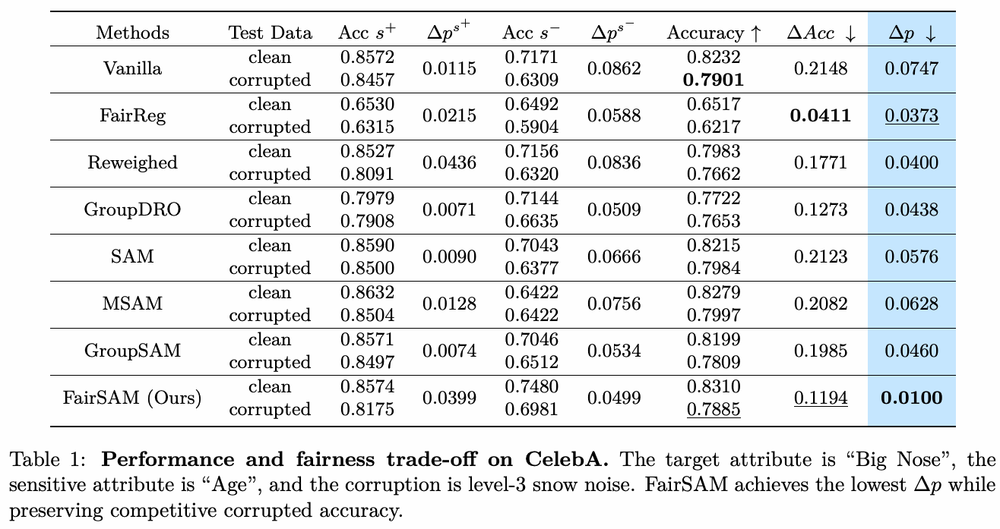
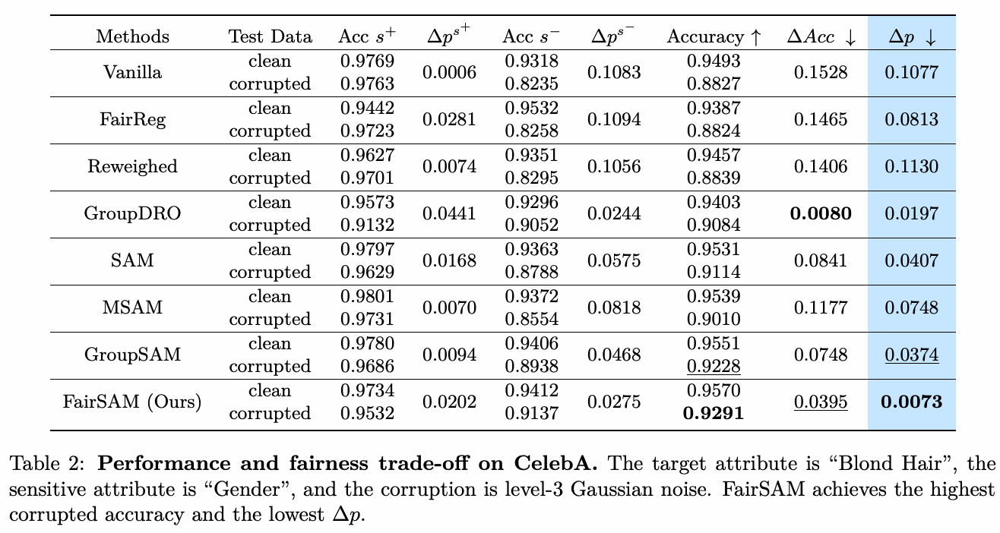
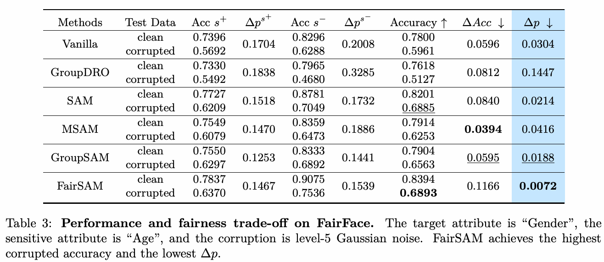
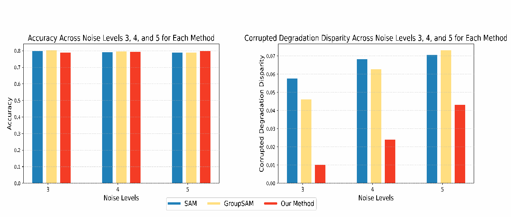

이번 글에서는 **FairSAM: Fair Classification on Corrupted Image Data Through Sharpness-Aware Minimization**을 정리한다. 깨끗한 이미지로 학습한 분류 모델이 손상된 이미지를 만났을 때, 성능 하락이 특정 집단에 집중되는 문제를 다룬 논문이다.

- **저자:** Yucong Dai, Jie Ji, Xiaolong Ma, Yongkai Wu
- **학술지:** Transactions on Machine Learning Research (TMLR), 2026년 6월
- **논문:** [OpenReview](https://openreview.net/forum?id=W2QKvn57yw)

---

## 1. Abstract

이미지가 흐려지거나 노이즈가 추가되면 분류 모델의 정확도가 떨어진다. 그런데 그 하락폭이 모든 demographic group에서 같지는 않다. 전체 정확도만 보면 큰 문제가 없어 보여도, 특정 성별이나 연령 집단에서는 성능이 훨씬 크게 떨어질 수 있다.

기존 SAM은 손실 지형에서 평평한 영역을 찾도록 학습해 일반화와 강건성을 개선하지만, 그 효과가 집단 사이에 어떻게 분배되는지는 직접 고려하지 않는다. 반대로 공정성만 고려한 방법은 손상된 데이터에서 전체 정확도를 충분히 유지하지 못할 수 있다.

이 논문의 핵심은 두 가지다.

1. **Corrupted Degradation Disparity:** 이미지 손상에 따른 성능 변화가 집단별로 얼마나 다른지 측정한다.
2. **FairSAM:** 집단별 총 가중치를 균등하게 배정하고, 각 집단 내부에서는 취약한 샘플을 강조하도록 SAM을 확장한다.

---

## 2. Introduction

### 2.1. 평균적인 강건성만으로는 부족하다

논문은 **clean data로 학습하고, corrupted data로 평가하는 상황**을 가정한다. 사용자 업로드 이미지나 모바일 촬영 이미지에는 Gaussian noise, impulse noise, 눈이나 안개, motion blur 같은 손상이 발생할 수 있다.

예를 들어 두 집단의 정확도가 모두 90%였는데, 이미지 손상 후 각각 85%와 70%가 되었다고 하자. 정확도 하락폭은 5%p와 20%p로, 두 집단이 입은 피해에는 15%p의 차이가 있다. 이미지 손상이 전체 성능을 낮추는 동시에 집단 간 격차도 만든 것이다.

따라서 다음 두 질문을 함께 봐야 한다.

> 이미지가 손상되어도 정확도를 잘 유지하는가? 그리고 그 성능 하락이 특정 집단에 집중되는가?

### 2.2. 기존 방법의 한계

기존 fairness 방법은 주로 특정 조건에서 집단 간 예측 비율이나 성능 차이를 줄인다. 하지만 손상 전후의 **변화량 차이**까지 직접 다루는 것은 아니다.

SAM 역시 전체 배치의 평균 손실을 기준으로 학습하므로, 표본 수가 많은 집단의 영향이 더 크게 반영될 수 있다. 전체적인 robustness가 좋아져도 소수 집단의 취약성이 충분히 개선된다고 보장할 수는 없다.

FairSAM은 이 지점에서 집단 정보와 개별 샘플의 중요도를 SAM에 반영한다.

---

## 3. Background

### 3.1. Fair Classification

입력 이미지 $x_i$, 예측 대상 $y_i$, 민감 속성 $s_i$를 구분한다. 예를 들어 CelebA에서 Big Nose를 예측하고 Age를 민감 속성으로 사용한다면, 얼굴 이미지로 코의 속성을 분류하면서 연령 집단별 성능을 비교한다.

주요 설정에서는 민감 속성을 두 집단 $S=\{s^+,s^-\}$으로 나눈다. 논문에서는 이를 각각 advantaged group과 disadvantaged group으로 표기한다.

일반적인 공정성 평가는 예측 결과나 오류율의 집단 간 차이를 본다. 이 논문은 여기에 **corruption 때문에 각 집단의 성능이 얼마나 달라지는지**를 추가한다.

### 3.2. Sharpness-Aware Minimization

일반적인 학습이 현재 파라미터 $w$에서의 손실을 줄인다면, SAM은 $w$ 주변에서 발생하는 최대 손실을 줄인다. 가중치 감쇠항을 생략하면 목적함수는 다음과 같다.

$$
\min_w \max_{\|\epsilon\|_2\leq\rho} L(w+\epsilon)
$$

안쪽 maximization은 손실을 가장 크게 만드는 파라미터 변화 $\epsilon$을 찾고, 바깥쪽 minimization은 그 주변 위치에서도 손실이 작아지도록 학습한다.

$L_2$ norm을 사용할 때 perturbation은 다음과 같이 근사한다.

$$
\hat\epsilon=\rho\frac{\nabla L(w)}{\|\nabla L(w)\|_2}
$$

손실이 증가하는 gradient 방향으로 반경 $\rho$만큼 이동한 뒤, 그 위치에서 gradient를 다시 계산해 원래 파라미터를 업데이트한다. 여기서 perturbation을 가하는 대상은 **입력 이미지가 아니라 모델 파라미터**다.

이 과정을 통해 파라미터가 조금 변해도 손실이 크게 증가하지 않는 flat minimum을 찾는다. 다만 평평한 해를 찾는 것 자체가 집단 간 공정성을 보장하지는 않는다.

---

## 4. Proposed Method

### 4.1. Corrupted Degradation Disparity

집단 $s$의 성능 변화량을 다음과 같이 정의한다.

$$
\Delta p^s=\left|M(D_T^{S=s},f)-M(D_C^{S=s},f)\right|
$$

$M$은 정확도 같은 성능 지표이며, $D_T$와 $D_C$는 각각 clean 데이터와 corrupted 데이터를 나타낸다. 원문 Definition 1은 clean training과 corrupted test를 기준으로 정의하고, 실험 설명에서는 clean/corrupted test를 비교한다. 따라서 실제로 지표를 계산할 때에는 clean 기준 데이터를 확인할 필요가 있다.

두 집단의 변화량 차이는 다음과 같다.

$$
\Delta p=\left|\Delta p^{s^+}-\Delta p^{s^-}\right|
$$

앞의 예시처럼 하락폭이 5%p와 20%p라면 $\Delta p=15\%p$다. 값이 작을수록 손상의 영향이 두 집단에 비슷하게 나타난다는 뜻이다.

**다만 $\Delta p=0$이 높은 정확도나 강건성을 뜻하지는 않는다.** 두 집단의 정확도가 모두 30%p씩 떨어져도 이 값은 0이다. 최종 정확도가 같은지를 보는 지표와도 다르므로, 전체 정확도와 집단별 정확도를 함께 확인해야 한다.

### 4.2. 집단별 총 가중치를 같게 배정한다

FairSAM은 각 집단에 동일한 가중치 예산 $c$를 배정한다. 초기 샘플 가중치는 다음과 같다.

$$
\gamma_i=\frac{c}{n_s},\qquad
\sum_{i\in g_s}\gamma_i=c,\quad \gamma_i\geq0
$$

$g_s$는 집단 $s$에 속한 샘플의 인덱스 집합이고, $n_s$는 그 집단의 샘플 수다.

예를 들어 A 집단에 900개, B 집단에 100개의 샘플이 있고 $c=1$이면 초기 가중치는 각각 $1/900$과 $1/100$이 된다. B의 샘플 하나는 A의 샘플 하나보다 9배 큰 가중치를 받지만, **집단 전체의 가중치 합은 둘 다 1**이다.

이렇게 하면 샘플 수가 많다는 이유만으로 한 집단이 목적함수를 지배하는 효과를 줄일 수 있다.

### 4.3. 집단 안에서는 어려운 샘플을 강조한다

집단별로 균등하게 배정한 예산을 모든 샘플에 계속 똑같이 나누는 것은 아니다. FairSAM은 각 집단 내부에서 파라미터 변화에 취약한 샘플에 더 집중한다.

샘플별 주변 최대 손실을

$$
r_i(w)=\max_{\|\epsilon_i\|_2\leq\rho}\ell_i(w+\epsilon_i)
$$

로 두면, 집단 내부의 가중치 문제는 다음과 같이 표현된다.

$$
\max_{\gamma}\sum_{i\in g_s}\gamma_i r_i(w)
\quad\text{s.t.}\quad
\sum_{i\in g_s}\gamma_i=c,\quad\gamma_i\geq0
$$

즉, **집단 사이에서는 총 가중치를 맞추고, 집단 안에서는 주변 최대 손실이 큰 샘플을 강조하는 것**이다. 단순히 소수 집단의 모든 샘플에 고정된 가중치를 주는 방식에서 한 단계 더 나아간다.

### 4.4. Per-batch Perturbation으로 계산한다

샘플마다 별도의 perturbation을 계산하면 비용이 크다. 논문은 이를 배치의 모든 샘플이 하나의 perturbation을 공유하는 방식으로 근사한다.

이때 샘플마다 최악의 방향을 따로 찾는 것과, 배치 전체에 공통으로 불리한 방향을 하나 찾는 것은 서로 다르다.

$$
\max_{\epsilon}\sum_i\gamma_i\ell_i(w+\epsilon)
\leq
\sum_i\gamma_i\max_{\epsilon_i}\ell_i(w+\epsilon_i)
$$

따라서 per-batch 계산은 per-sample 목적과 정확히 같은 계산이 아니라 효율적인 근사다.

논문은 2차 Taylor 전개와 저랭크 Hessian 가정을 사용해 샘플의 sharpness와 gradient 크기를 반영한 가중 배치 손실을 구성한다.

$$
\ell_b(w)=\sum_i g_i\ell_i(w),\qquad
\epsilon^*=\rho\frac{\nabla\ell_b(w)}{\|\nabla\ell_b(w)\|_2}
$$

여기서 원문의 가중치는 $g_i=a_i\|\nabla\ell_i(w)\|_2$로 표현되며, $a_i$는 sharpness 관련 계수다. 집단별 공정성 제약과 샘플의 어려움을 반영한 손실로 **SAM의 perturbation 방향을 정한다**는 것이 핵심이다. perturbation을 구한 뒤에는 SAM과 같이 주변 위치에서 gradient를 계산해 업데이트한다.

---

## 5. Experiments

### 5.1. 실험 설정

노션에서 정리한 주요 데이터셋은 CelebA와 FairFace다.

| 데이터셋 | 예측 대상 | 민감 속성 | 확인하려는 점 |
| --- | --- | --- | --- |
| CelebA | Big Nose / Blond Hair | Age / Gender | 집단 크기가 불균형한 환경에서의 효과 |
| FairFace | Gender | Age | 비교적 균형 잡힌 집단에서도 효과가 있는지 |

기본 backbone은 ResNet-18이다. 깨끗한 데이터로 학습하고, ImageNet-C 설정에 따라 눈, Gaussian noise, blur 등의 손상을 가한 데이터로 평가한다. 손상 강도는 1~5이며 기본 하이퍼파라미터는 $c=1$, $\rho=0.05$다.

비교 대상에는 Vanilla, FairReg, Reweighed, GroupDRO, SAM, MSAM, GroupSAM이 포함된다. 이 중 GroupSAM은 **불리한 집단에만 SAM을 적용**하는 방법이다. FairSAM과 비교하면 취약 집단을 선택하는 것에 더해 집단 내부의 샘플 중요도를 반영하는 효과를 볼 수 있다.

### 5.2. CelebA: 정확도와 공정성의 관계

*Table 1. Big Nose 분류, 민감 속성 Age, level-3 snow corruption. 출처: FairSAM 논문.*

첫 번째 실험에서 FairSAM의 $\Delta p$는 **0.0100**으로, SAM의 0.0576보다 작다. 하지만 corrupted accuracy는 FairSAM이 **78.85%**, SAM이 **79.84%**다.

따라서 이 결과는 정확도를 무조건 높였다기보다, 정확도가 소폭 낮아지는 대신 집단별 성능 하락 차이를 크게 줄였다고 읽는 것이 맞다.

*Table 2. Blond Hair 분류, 민감 속성 Gender, level-3 Gaussian noise. 출처: FairSAM 논문.*

두 번째 실험에서는 FairSAM이 corrupted accuracy **92.91%**, $\Delta p=0.0073$으로 두 지표 모두 가장 좋은 결과를 보인다. SAM은 각각 91.14%, 0.0407이다.

즉, 공정성과 정확도를 동시에 개선하는 경우도 있지만, **설정에 따라 trade-off가 존재한다.**

### 5.3. FairFace: 집단 크기가 균형 잡혀 있어도 유효한가?

*Table 3. Gender 분류, 민감 속성 Age, level-5 Gaussian noise. 출처: FairSAM 논문.*

FairFace에서 FairSAM의 corrupted accuracy는 **68.93%**, $\Delta p$는 **0.0072**다. SAM의 68.85%, 0.0214와 비교하면 정확도 차이는 작지만 성능 하락 격차는 줄어든다.

다만 최종 집단 간 정확도 차이인 $\Delta\mathrm{Acc}$는 FairSAM이 0.1166으로, SAM의 0.0840보다 크다. **성능 하락폭을 비슷하게 만드는 것과 최종 정확도를 같게 만드는 것은 다른 목표**라는 점이 여기서도 드러난다.

이 결과는 FairSAM의 효과를 집단 크기 불균형 보정만으로 설명하기 어렵다는 것을 보여준다.

### 5.4. 손상 강도와 데이터셋 변화

*Figure 1. Snow corruption에서 SAM 계열 방법의 정확도와 성능 하락 격차 비교. 출처: FairSAM 논문.*

손상 강도를 달리한 비교에서도 FairSAM은 비슷한 수준의 정확도를 유지하면서 더 작은 성능 하락 격차를 보인다.

CelebA에서 학습하고 LFW에서 평가하거나 그 반대로 평가하는 실험에서도, FairSAM은 비교한 SAM 계열 방법 중 가장 작은 degradation disparity를 보였다. 다만 이 실험은 이미지에 노이즈를 추가하는 설정과 달리 **데이터셋 변화에 따른 집단별 성능 변화 차이**를 평가한 결과다.

---

## 6. Conclusion

FairSAM은 모델이 평균적으로 얼마나 강건한가에서 한 걸음 더 나아가, **그 강건성이 집단 사이에 어떻게 분배되는가**를 묻는다.

이를 위해 집단별 성능 변화 차이를 측정하는 지표를 제안하고, 집단별 총 가중치와 집단 내부 샘플의 중요도를 반영해 SAM을 확장한다. 복잡한 샘플별 perturbation은 배치 단위 계산으로 근사한다.

읽으면서 가장 중요하게 본 부분은 정확도, 최종 집단 간 성능 격차, 성능 하락 격차를 구분해야 한다는 점이다. $\Delta p$가 작다고 모델이 충분히 강건하거나 모든 의미에서 공정한 것은 아니다. 각 지표를 함께 봐야 FairSAM이 어떤 부분을 개선했는지 알 수 있다.

주요 실험은 이진 민감 속성을 사용하는 이미지 분류에 집중되어 있다. 여러 민감 속성이 겹치는 집단이나 다른 task에서도 같은 효과가 나타나는지는 후속 검증이 필요하다.
